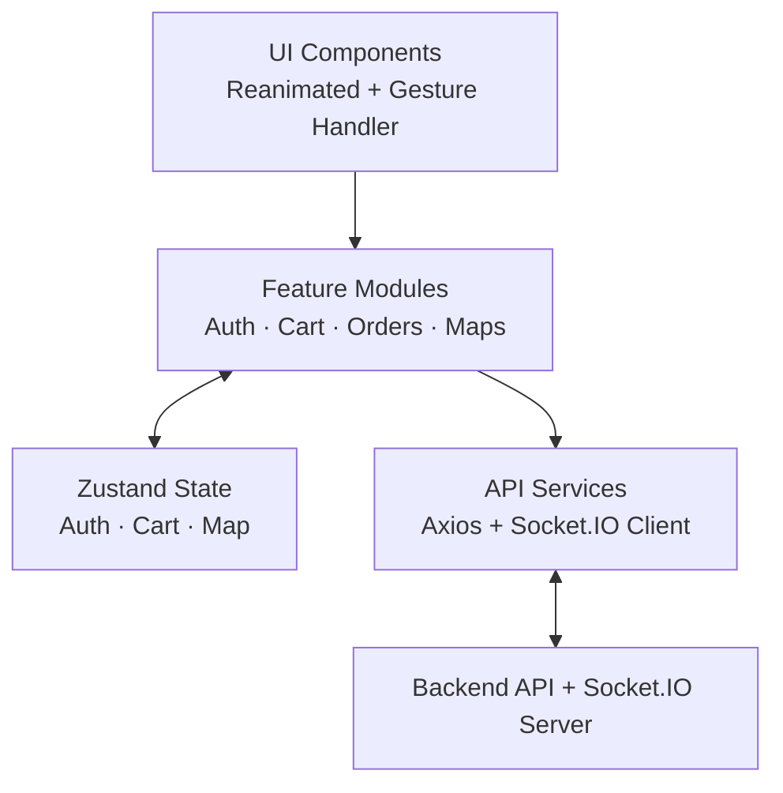
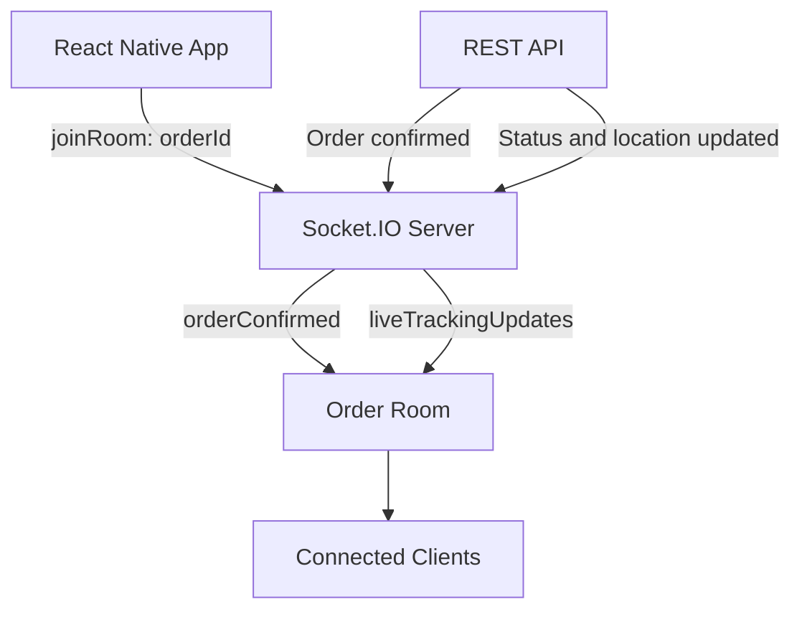
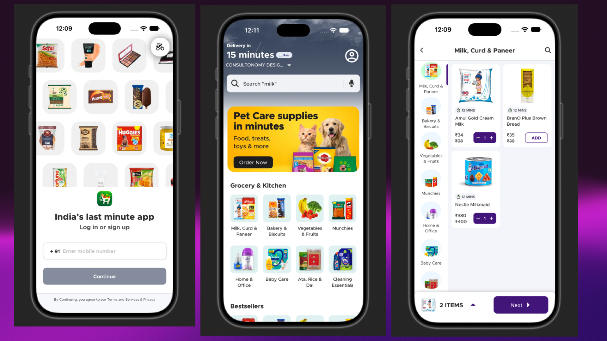
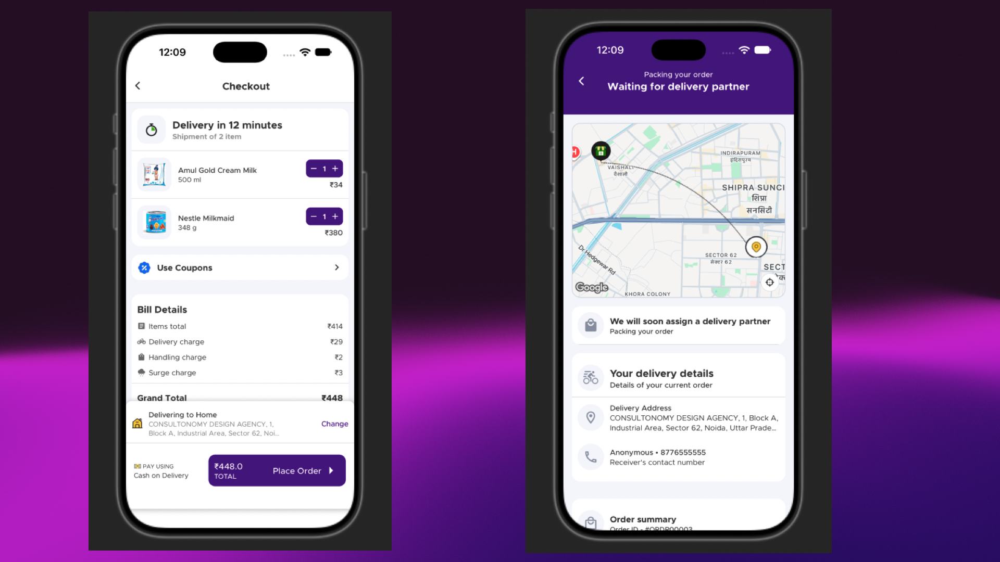
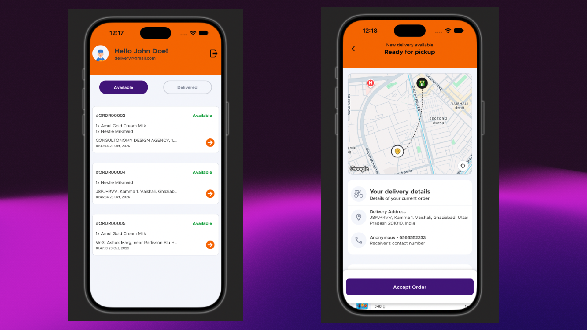

<a id="top"></a>

<div align="center">
  

  <h1>🛒 FreshMart</h1>
  <h2>A modern grocery delivery app built with React Native CLI</h2>
  <p>Explore groceries, manage your cart, and track deliveries with
  interactive maps and real-time order updates.</p>
  <p><em>Google Maps integration · Gesture-driven UI · Feature-based architecture</em></p>

  <p>
    <a href="https://reactnative.dev/"></a>
    <a href="https://www.typescriptlang.org/"></a>
    <a href="https://zustand.docs.pmnd.rs/"></a>
    <a href="https://socket.io/"></a>
    <a href="https://docs.swmansion.com/react-native-reanimated/"></a>
  </p>

  <p>
    <a href="#-demo">▶ Watch Demo</a> ·
    <a href="#-features">✨ Features</a> ·
    <a href="#-tech-stack">🧱 Tech Stack</a> ·
    <a href="#-architecture">🏗 Architecture</a> ·
    <a href="#-getting-started">🚀 Getting Started</a> ·
    <a href="#-screenshots">📸 Screenshots</a>
  </p>
</div>

---

## 📑 Table of Contents

<details>
<summary><strong>Open README navigation</strong></summary>

- [Overview](#-overview)
- [Demo](#-demo)
- [Features](#-features)
- [Tech Stack](#-tech-stack)
- [Project Structure](#-project-structure)
- [Architecture](#-architecture)
- [State Management](#-state-management)
- [Real-Time Updates](#-real-time-updates)
- [Storage](#-storage)
- [Screenshots](#-screenshots)
- [Getting Started](#-getting-started)
- [Troubleshooting](#-troubleshooting)
- [Scripts](#-scripts)
- [Author](#-author)

</details>

---

## 📱 Overview

**FreshMart** is a grocery delivery mobile application built with **React Native CLI** and **TypeScript**. It combines product browsing, cart management, authentication flows, order management, and interactive map-based delivery tracking.

The application follows a modular, feature-based architecture. It uses Zustand for state management and includes native map integration, gesture handling and animations, persistent local storage, and Socket.IO for real-time communication with the backend.

<p align="right"><a href="#top">⬆ Back to top</a></p>

---

## 🎬 Demo

<div align="center">
  <h3>Watch the FreshMart app walkthrough</h3>
  <a href="https://youtu.be/K3bmgN-bZFA">
    
  </a>
  <p><a href="https://youtu.be/K3bmgN-bZFA"><strong>▶ Watch on YouTube</strong></a></p>
</div>

<p align="right"><a href="#top">⬆ Back to top</a></p>

---

## ✨ Features

<details open>
<summary><strong>🛍️ Shopping Experience</strong></summary>

- **Product browsing:** Explore products organized by category.
- **Cart management:** Add or remove items, adjust quantities, and update cart totals.
- **Authentication:** Sign in and keep your session saved across app launches.

</details>

<details open>
<summary><strong>📦 Orders and Delivery</strong></summary>

- **Order tracking:** Follow order progress from placement through delivery.
- **Real-time delivery updates:** Receive live order status and delivery partner location updates via Socket.IO.
- **Map and route display:** Visualize delivery locations, map markers, and routes using Google Maps integration.

</details>

<details open>
<summary><strong>⚡ UI, Animation, and Performance</strong></summary>

- **Gesture-driven interactions:** Use responsive gestures built with React Native Gesture Handler and Reanimated.
- **Lottie animations:** Add engaging animations to key interactions.
- **Carousels and banners:** Browse products through interactive carousels and scrolling banners.
- **Gradients and SVG:** Enhance UI elements with linear gradients and SVG graphics.
- **Responsive typography:** Scale text sizes across different screen sizes for a consistent UI.

</details>

<p align="right"><a href="#top">⬆ Back to top</a></p>

---

## 🧱 Tech Stack

| Technology | Purpose |
|---|---|
| **React Native CLI** | Native Android and iOS application framework |
| **TypeScript** | Static typing across the application |
| **React Navigation** | Native stack navigation |
| **Zustand** | Global state management |
| **Axios** | HTTP requests to backend APIs |
| **Socket.IO Client** | Event-driven, real-time communication |
| **React Native Maps** | Native maps and markers |
| **React Native Maps Directions** | Route rendering between coordinates |
| **React Native Reanimated** | High-performance UI animations |
| **React Native Gesture Handler** | Touch and gesture interactions |
| **React Native MMKV** | Native key-value persistence |
| **Lottie React Native** | JSON-based animations |
| **React Native SVG** | SVG rendering |
| **React Native Community Geolocation** | Device location access |

<p align="right"><a href="#top">⬆ Back to top</a></p>

---

## 📂 Project Structure

<details open>
<summary><strong>View Folder Layout</strong></summary>

```text
react-native-freshmart/
├── android/                 # Android native project
├── ios/                     # iOS native project
├── src/
│   ├── assets/              # Images, Lottie files, and fonts
│   ├── components/          # Shared UI components
│   ├── features/            # Feature modules: auth, cart, orders, maps
│   ├── navigation/          # Stack and tab navigation
│   ├── service/             # API clients and service functions
│   ├── state/               # Zustand stores
│   ├── styles/              # Theme tokens and style utilities
│   └── utils/               # Shared helper functions
├── package.json
└── README.md
```

</details>

<p align="right"><a href="#top">⬆ Back to top</a></p>

---

## 🏗 Architecture



The architecture is designed to support:

- **Modularity:** Organize functionality into focused, maintainable feature modules.
- **Separation of concerns:** Keep UI components, state management, and network operations separate.
- **Shared state:** Manage application-wide data efficiently using Zustand.
- **Real-time communication:** Support live order status and delivery partner location updates using Socket.IO.

<p align="right"><a href="#top">⬆ Back to top</a></p>

---

## 🧠 State Management

The application organizes global state into three Zustand stores.

| Store | Responsibility |
|---|---|
| `authStore` | Authentication state, user details, tokens, and login/logout actions |
| `cartStore` | Cart items, quantities, and cart totals |
| `mapStore` | Delivery coordinates and delivery partner location |

<p align="right"><a href="#top">⬆ Back to top</a></p>

---

## ⚡ Real-Time Updates

FreshMart uses Socket.IO to deliver order-specific updates and delivery partner location data to connected clients.

- **Order confirmation:** Notify connected clients when a delivery partner confirms an order through the `orderConfirmed` event.
- **Live tracking:** Receive updated order status and delivery partner location data through the `liveTrackingUpdates` event.
- **Order-specific rooms:** Join Socket.IO rooms using an order ID to receive updates for the relevant order.



<p align="right"><a href="#top">⬆ Back to top</a></p>

---

## 💾 Storage

FreshMart uses **React Native MMKV** for native key-value persistence.

MMKV supports persistent storage for authentication/session data and cart contents.

<p align="right"><a href="#top">⬆ Back to top</a></p>

---

## 📸 Screenshots

| Authentication, Home & Categories | Checkout & Order Tracking | Delivery Partner & Tracking |
|:---:|:---:|:---:|
|  |  |  |

<p align="right"><a href="#top">⬆ Back to top</a></p>

---

## 🚀 Getting Started

### 1. Prerequisites

- **Node.js and npm:** Install Node.js (which includes npm) and make sure both are available in your terminal.
- **React Native environment:** Follow the [official environment setup guide](https://reactnative.dev/docs/set-up-your-environment).
- **Android:** Install Android Studio and configure an emulator or connected device.
- **iOS:** Use macOS with Xcode, CocoaPods, and the repository's Ruby/Bundler setup.

### 2. Clone the Repository

```bash
git clone https://github.com/krishnakmr08/react-native-freshmart.git
cd react-native-freshmart
```

### 3. Install Dependencies

```bash
npm install
```

For iOS, first run `bundle install` from the directory containing the repository's `Gemfile` if the Ruby/Bundler dependencies have not been installed. Then install the CocoaPods dependencies from the project root:

```bash
npm run pod-install
```

### 4. Start Metro

Open a terminal in the project directory and run:

```bash
npm start
```

Keep Metro running while launching the application.

### 5. Run the Application

For Android, open a second terminal and run:

```bash
npm run android
```

For iOS on macOS, run:

```bash
npm run ios
```

<p align="right"><a href="#top">⬆ Back to top</a></p>

---

## 🛠 Troubleshooting

- **Custom fonts are missing:** Run `npm run link:fonts` if the project uses configured custom fonts.
- **Metro cache issues:** Restart Metro with `npm start -- --reset-cache`.
- **iOS CocoaPods errors:** Check your Ruby, Bundler, and CocoaPods configuration before retrying `npm run pod-install`.
- **Reanimated or Worklets errors:** Verify the Babel and native configuration, then rebuild the application if required.

<p align="right"><a href="#top">⬆ Back to top</a></p>

---

## 🧰 Scripts

| Command | Description |
|---|---|
| `npm start` | Start the Metro bundler |
| `npm run android` | Build and launch the Android application |
| `npm run ios` | Build and launch the iOS application |
| `npm run pod-install` | Install iOS CocoaPods dependencies using Bundler |
| `npm run link:fonts` | Run `react-native-asset` for configured assets |

<p align="right"><a href="#top">⬆ Back to top</a></p>

---

## 👤 Author

**Krishna Kumar**

<br />

<sub>React Native Developer — TypeScript · React Native · Reanimated · Node.js</sub>

<br /><br />

[](https://github.com/krishnakmr08)

<p align="right"><a href="#top">⬆ Back to top</a></p>
